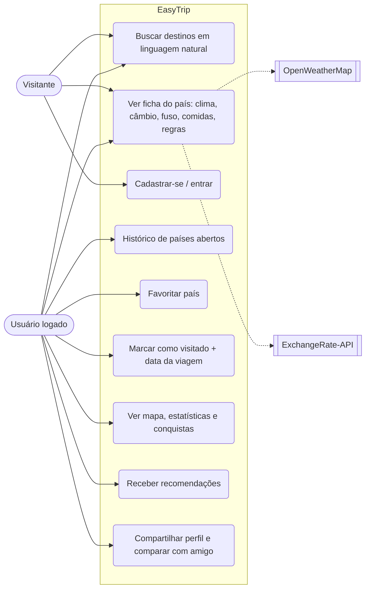
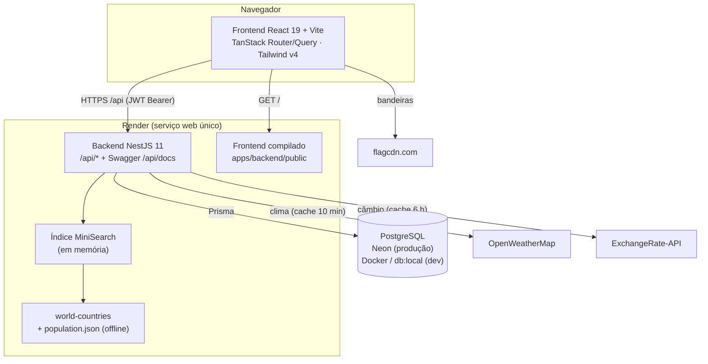
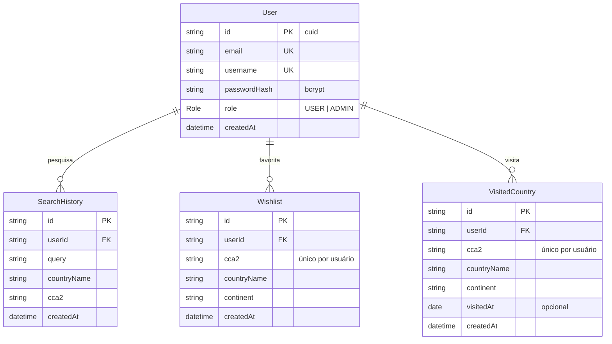
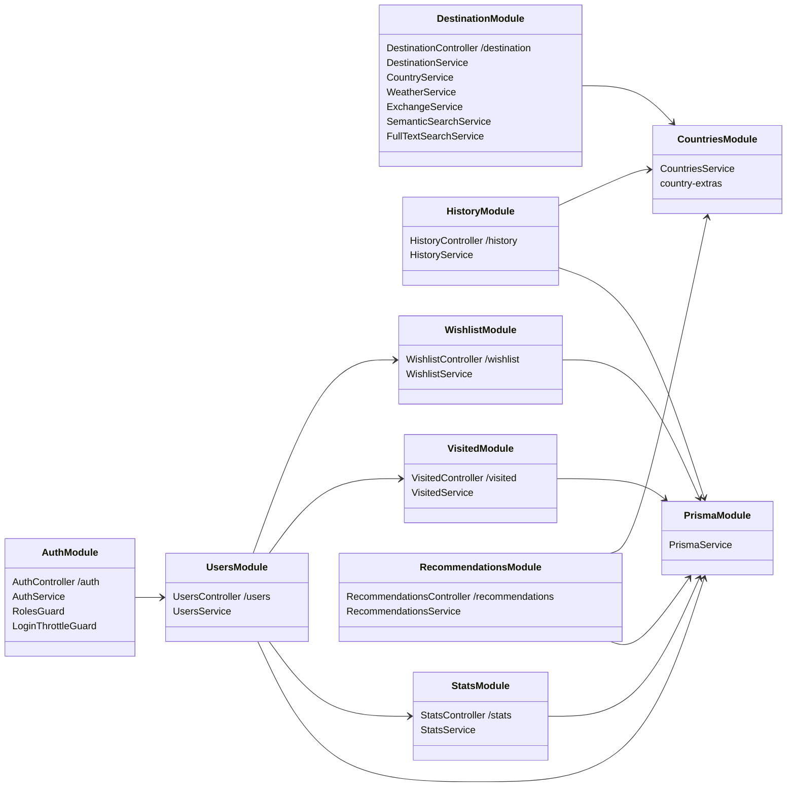
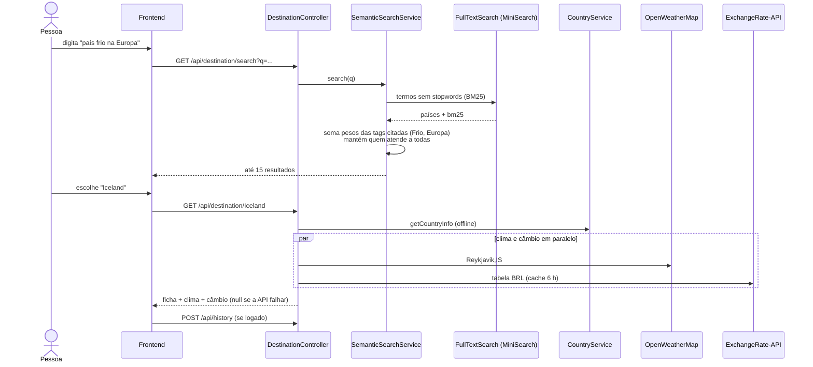
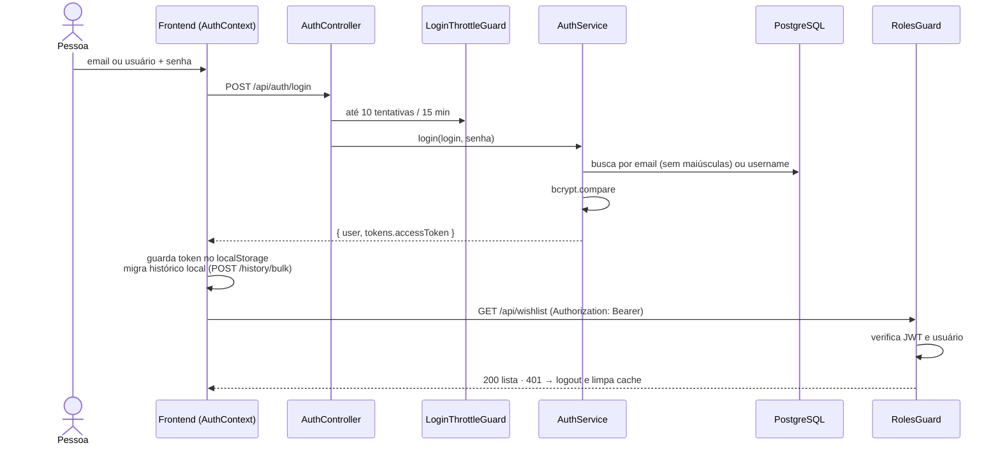
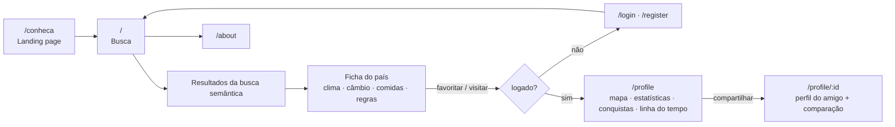

# Modelagem do sistema — diagramas

Diagramas em [Mermaid](https://mermaid.js.org), renderizados pelo próprio GitHub. Todos foram tirados do código atual (rotas, módulos e `schema.prisma`).

1. [Casos de uso](#1-casos-de-uso)
2. [Arquitetura e implantação](#2-arquitetura-e-implantação)
3. [Modelo de dados (ER)](#3-modelo-de-dados-er)
4. [Módulos do backend](#4-módulos-do-backend)
5. [Sequência — busca e abertura de um país](#5-sequência--busca-e-abertura-de-um-país)
6. [Sequência — cadastro, login e rota protegida](#6-sequência--cadastro-login-e-rota-protegida)
7. [Fluxo de telas](#7-fluxo-de-telas)

---

## 1. Casos de uso

O visitante busca e consulta países com histórico guardado no navegador; ao entrar, o histórico migra para o servidor.

## 2. Arquitetura e implantação

Monorepo Turborepo: `apps/frontend`, `apps/backend` e `packages/shared` (tipos e schemas Zod usados pelos dois lados).

## 3. Modelo de dados (ER)

Os países não ficam no banco: vêm do pacote `world-countries` (offline). O banco guarda só o que é do usuário. Apagar um usuário apaga em cascata o histórico, os favoritos e os visitados.

## 4. Módulos do backend

## 5. Sequência — busca e abertura de um país

## 6. Sequência — cadastro, login e rota protegida

## 7. Fluxo de telas

