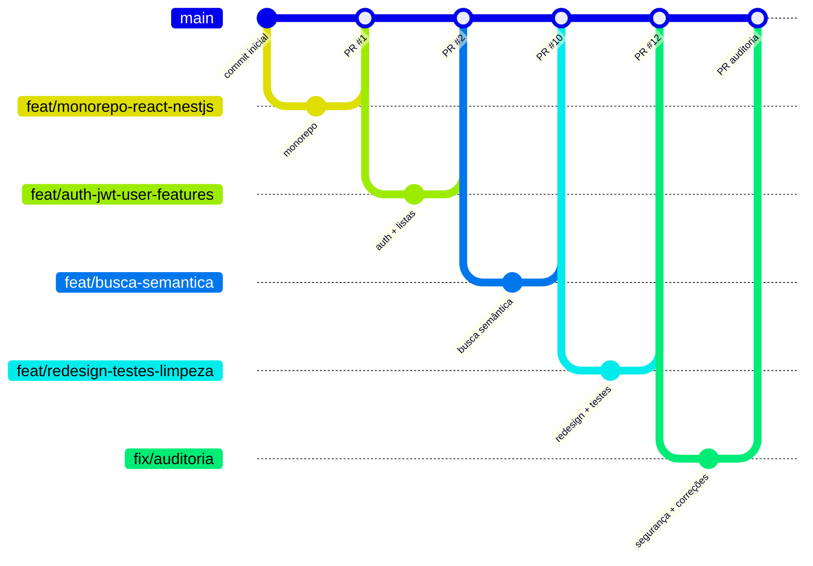

# Metodologia ágil — Scrum no EasyTrip

O time trabalhou em ciclos curtos com entregas incrementais. Cada funcionalidade nasceu em uma branch `feat/*` ou `fix/*` e entrou na `main` por Pull Request revisado (PRs #1 a #13 no repositório do grupo). As datas e entregas abaixo foram reconstruídas a partir do histórico do Git dos repositórios [marcella-81/EasyTrip](https://github.com/marcella-81/EasyTrip) e [paulahaas/EasyTrip](https://github.com/paulahaas/EasyTrip).

## Papéis

| Papel | Responsável |
| --- | --- |
| Product Owner | _(preencher pela equipe)_ |
| Scrum Master | _(preencher pela equipe)_ |
| Time de desenvolvimento | Marcella Cagliari, Richard Pompeo, Paula Haas, Pedro Cardoso, Gustavo Correia |

## Artefatos

- **Product Backlog:** lista priorizada abaixo, escrita como histórias de usuário.
- **Sprint Backlog:** as histórias de cada sprint (tabela de sprints).
- **Incremento:** cada sprint terminou com a `main` funcionando; desde outubro o incremento é publicado automaticamente no Render a cada push.
- **Definição de Pronto:** código em PR revisado, testes passando (Jest e Vitest), lint limpo e README/docs atualizados.

## Eventos

> Revisem esta tabela antes da banca: ela descreve o formato dos eventos, e só a equipe sabe como cada um aconteceu na prática.

| Evento | Como o time fez |
| --- | --- |
| Sprint Planning | Escolha das histórias do backlog para o ciclo e divisão por pessoa |
| Daily | Alinhamento rápido no grupo da equipe |
| Sprint Review | Demonstração do incremento rodando (localhost e, depois, no Render) |
| Retrospectiva | Lições registradas no `RELATORIO.md` (o que mudou e por quê) |

## Product Backlog

| # | História de usuário | Prioridade | Status |
| --- | --- | --- | --- |
| H1 | Como viajante, quero buscar países descrevendo o que procuro ("país frio", "fala espanhol") | Alta | Pronto |
| H2 | Como viajante, quero ver clima e câmbio em reais do destino | Alta | Pronto |
| H3 | Como viajante, quero criar conta e entrar com email ou nome de usuário | Alta | Pronto |
| H4 | Como usuário, quero favoritar países e marcar os que já visitei | Alta | Pronto |
| H5 | Como usuário, quero ver meu mapa do mundo e estatísticas por continente | Média | Pronto |
| H6 | Como usuário, quero recomendações a partir do que pesquisei | Média | Pronto |
| H7 | Como usuário, quero compartilhar meu perfil e comparar com um amigo | Média | Pronto |
| H8 | Como viajante, quero a ficha completa: fuso, DDI, mão de direção, comidas e regras locais | Média | Pronto |
| H9 | Como usuário, quero registrar a data da viagem e ver a linha do tempo e conquistas | Baixa | Pronto |
| H10 | Como time, queremos o sistema publicado na nuvem | Alta | Pronto (Render + Neon) |
| H11 | Como visitante, quero uma landing page que explique o produto | Média | Pronto (tela inicial `/`) |
| H12 | Como time, queremos auditoria de qualidade e segurança | Alta | Pronto (nov/2026) |
| H13 | Mapa offline das bandeiras e PWA | Baixa | Backlog |
| H14 | Perfil compartilhado visível sem login (opção de privacidade) | Baixa | Backlog |

## Sprints

| Sprint | Período | Entregas | Quem |
| --- | --- | --- | --- |
| 0 — Concepção | 07–08/04/2026 | Repositório, README inicial, ideia do produto | Marcella |
| 1 — Fundação | 14/04/2026 | Monorepo Turborepo + NestJS + React; histórico local (PR #1) | Richard |
| 2 — Usuário | 23/04/2026 | Auth JWT, wishlist, visitados, recomendações, estatísticas, RBAC, perfil compartilhável, Swagger, gráficos e mapa (PRs #2–#8) | Richard |
| 3 — Busca | 19/05/2026 | Busca semântica por atributos; confirmação de senha (PRs #9–#10) | Richard |
| 4 — Polimento | 09–18/06/2026 | Comentários nos componentes, página Sobre, README final, redesign, testes, documentação técnica (PRs #11–#13) | Gustavo, Paula, Pedro, Richard |
| 5 — Produção | 15–21/10/2026 | Roda sem Docker (Windows/Linux), deploy Render + Neon, nome de usuário, população real, ficha completa do país, conquistas, linha do tempo, comparação | Paula |
| 6 — Qualidade | 22–23/11/2026 | README completo; auditoria: segurança (JWT, rate limit, seed), correções de busca e mapa, tokens de design, landing page, diagramas | Paula, Pedro |

## Fluxo de trabalho no Git

Commits seguem Conventional Commits (`feat:`, `fix:`, `docs:`, `refactor:`, `style:`).
